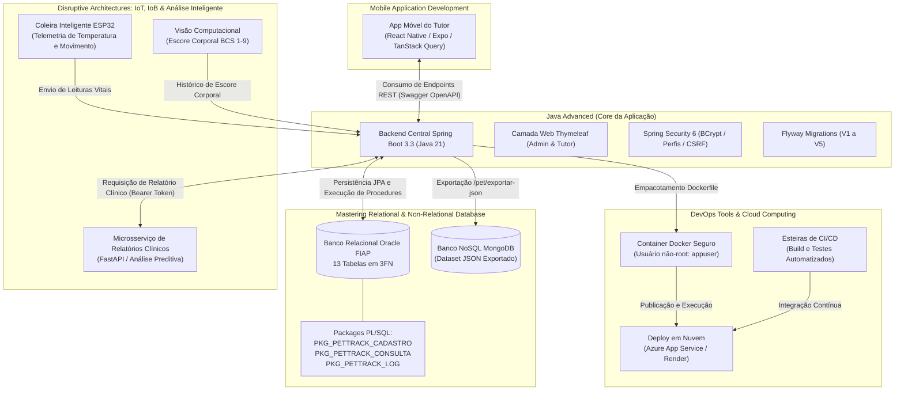

# 🐾 PetTrack — Sistema Operacional de Saúde Animal e Monitoramento Contínuo

> **FIAP Challenge 2026 · 2º Ano ADS (Turma 2TDSPF · 2º Semestre)**  
> **Disciplina:** Java Advanced — **Sprint 4: Consolidação Final, Deploy Online, Procedures Oracle, Relatórios de Saúde e Integração Multidisciplinar**  
> **Parceiro de Negócio:** Clyvo Vet  

---

## 👥 Integrantes do Grupo

| Nome Completo | RM | Turma | Papel e Responsabilidades no Projeto |
| :--- | :--- | :--- | :--- |
| **Gabriel Sbrana Campos** | RM 565849 | 2TDSPF | Backend Architecture · Entidades JPA · Cache · Migrations Flyway · Deploy |
| **Moisés Waidemann Molinillo Júnior** | RM 563719 | 2TDSPF | DTOs · Bean Validation · Paginação · Notificações · Fluxo de Adesão |
| **Thiago Rodrigues da Mota** | RM 563650 | 2TDSPF | Web Controllers · Regras do Health Score · Documentação OpenAPI · UI/UX Thymeleaf |
| **Richard Freitas** | RM 566127 | 2TDSPF | Tratamento Global de Exceções · Integrações de Serviços · Testes Automatizados |

---

## 🔗 Links Oficiais da Entrega Final (Sprint 4)

* 🎥 **Vídeo de Demonstração e Apresentação da Solução (YouTube - Máx. 15 minutos):**  
  > **[https://youtu.be/RfjquTERG8w](https://youtu.be/RfjquTERG8w)**  
  > *(Apresentação completa com participação dos 4 integrantes, demonstrando a narrativa de negócio, decisões de arquitetura, navegação pelos fluxos do sistema, tela de acesso negado 403, persistência no banco Oracle e deploy online).*
* 🌐 **Link da Aplicação em Nuvem (Deploy Online):**  
  > `https://pettrack-app.azurewebsites.net` *(Espelho alternativo: `https://pettrack-java.onrender.com`)*  
  > *(Para execução e testes locais durante a avaliação: `http://localhost:8080`)*
* 💻 **Repositório GitHub do Projeto:**  
  > **[https://github.com/Challenge-PetTrack/JAVA-ADVANCED.git](https://github.com/Challenge-PetTrack/JAVA-ADVANCED.git)** *(Branch principal: `main`)*
* 📑 **Documentação da API REST (OpenAPI 3.0 / Swagger UI):**  
  > `http://localhost:8080/swagger` ou `http://localhost:8080/swagger-ui/index.html`

---

## 📋 Sumário
1. [Sobre o Projeto PetTrack & Alinhamento com a Clyvo Vet](#-sobre-o-projeto-pettrack--alinhamento-com-a-clyvo-vet)
2. [Narrativa da Solução, Decisões de Design e Justificativas](#-narrativa-da-solução-decisões-de-design-e-justificativas)
3. [Demonstração Técnica da Solução e Conceitos Aplicados](#-demonstração-técnica-da-solução-e-conceitos-aplicados)
4. [Principais Fluxos de Negócio Implementados](#-principais-fluxos-de-negócio-implementados)
5. [Segurança e Controle de Acesso Granular (Spring Security 6)](#-segurança-e-controle-de-acesso-granular-spring-security-6)
6. [Integração Multidisciplinar e Evidências](#-integração-multidisciplinar-e-evidências)
7. [Mapeamento Completo de Rotas e Telas](#-mapeamento-completo-de-rotas-e-telas)
8. [Credenciais Pré-configuradas para Testes](#-credenciais-pré-configuradas-para-testes)
9. [Instruções de Instalação e Execução](#-instruções-de-instalação-e-execução)
10. [Execução dos Testes Automatizados](#-execução-dos-testes-automatizados)
11. [Roteiro do Vídeo de Apresentação e Participação da Equipe](#-roteiro-do-vídeo-de-apresentação-e-participação-da-equipe)

---

## 🩺 Sobre o Projeto PetTrack & Alinhamento com a Clyvo Vet

O mercado veterinário enfrenta uma limitação estrutural na gestão de cuidados animais: a **jornada do paciente pet é essencialmente reativa e descontinuada**. Em geral, tutores apenas comparecem à clínica veterinária em situações emergenciais ou manifestações clínicas graves, gerando baixos índices de adesão terapêutica, ausência de monitoramento preventivo e perda do histórico evolutivo do animal.

O **PetTrack**, desenvolvido em parceria com a **Clyvo Vet**, propõe a transição desse paradigma para um **modelo de cuidado preventivo e contínuo**, atuando como sistema operacional centralizado que conecta clínicas veterinárias, médicos veterinários e tutores através de:

1. **Ingestão e Monitoramento de Telemetria (Sinais Vitais):** Acompanhamento de temperatura corporal e nível de atividade física emitidos por coleiras inteligentes.
2. **Cálculo Dinâmico de Health Score (0 a 100):** Algoritmo paramétrico que pondera sinais vitais em tempo real, estabilidade de escore corporal (BCS), histórico clínico recente e taxa de cumprimento medicamentoso.
3. **Gestão de Adesão Medicamentosa com Alertas Clínicos:** Acompanhamento interativo de posologias prescritas, permitindo ao tutor registrar doses tomadas e emitindo alertas automáticos à equipe veterinária em caso de descontinuidade ou esquecimento.
4. **Geração e Persistência de Relatórios de Saúde (Health Reports):** Consolidação automática do histórico completo do paciente (telemetria 24h, escore corporal BCS, consultas, medicamentos prescritos, vacinação e contexto meteorológico regional), persistindo snapshots auditáveis para suporte à decisão clínica e orientação do tutor.

---

## 🏛️ Narrativa da Solução, Decisões de Design e Justificativas

A arquitetura do PetTrack foi desenhada visando robustez técnica, alta coesão, baixo acoplamento e conformidade estrita com boas práticas de engenharia de software corporativo:

### 1. Escolha Tecnológica: Java 21 LTS e Spring Boot 3.3
* **Concorrência e Escalabilidade:** Aproveitamento dos recursos contemporâneos do Java 21, com suporte nativo a processamento assíncrono e segurança de tipos em todo o pipeline de dados.
* **Ecossistema Integrado:** O Spring Boot 3.3 consolida injeção de dependências controlada, gerenciamento transacional declarativo (`@Transactional`), segurança robusta com Spring Security 6 e facilidade de integração com bancos de dados legados e modernos.

### 2. Clean Architecture e Separação de Camadas
A estrutura de pacotes da aplicação isola estritamente as responsabilidades:
* **`com.fiap.pettrack.control`:** Controladores de API REST (`PetController`, `HealthReportController`, `HealthContextController`, etc.), responsáveis por validação de entrada, negociação de conteúdo e retorno de códigos HTTP semânticos.
* **`com.fiap.pettrack.web`:** Controladores de visualização MVC (`AdminWebController`, `TutorWebController`, `HealthReportWebController`, `AuthController`), orquestrando as telas Thymeleaf e separando a lógica de apresentação dos dados.
* **`com.fiap.pettrack.service` e `com.fiap.pettrack.service.fluxos`:** Camada de domínio onde residem as regras de negócio, cálculos matemáticos do Health Score, detecção de padrões clínicos de risco e transações.
* **`com.fiap.pettrack.repository`:** Abstração de persistência através de interfaces Spring Data JPA e implementações dedicadas com JDBC (`PetProcedureRepository`) para execução de Stored Procedures Oracle.
* **`com.fiap.pettrack.dto` e `com.fiap.pettrack.mapper`:** Proteção das entidades JPA contra vazamento de detalhes estruturais. A conversão bidirecional entre DTOs e entidades é realizada com o **MapStruct 1.6**, gerando mappers performáticos e seguros em tempo de compilação sem sobrecarga de reflexão.
* **`com.fiap.pettrack.validations`:** Regras de validação centralizadas através de Bean Validation (`jakarta.validation`) e classes especializadas (`GerenciadorValidacoes`), garantindo consistência em formulários e payloads JSON.
* **`com.fiap.pettrack.config`:** Configurações centralizadas de segurança, OpenAPI, cache, Flyway e clientes HTTP.

### 3. Padrões SOLID e Práticas de Clean Code
* **Single Responsibility Principle (SRP):** Classes focadas em uma única finalidade (ex.: separação entre `PetCachingService` para leitura em cache, `PetPaginacaoService` para consultas paginadas e `PetProcedureService` para operações via stored procedures).
* **Dependency Inversion Principle (DIP):** Injeção de dependências rigorosamente realizada via construtores com imutabilidade (`final` + Lombok `@RequiredArgsConstructor`), viabilizando a injeção de mocks e facilidade de testes unitários.
* **Don't Repeat Yourself (DRY):** Reutilização de código através de fragmentos modulares em Thymeleaf (`fragments/layout.html`), tratamento de exceções globalmente compartilhado e classes base de DTO.

### 4. Tratamento Global de Exceções Padronizado
Implementado com `@ControllerAdvice` e `GlobalExceptionHandler`, interceptando violações de integridade relacional, dados inválidos em formulários, entidades não localizadas e indisponibilidade de serviços externos. O tratamento retorna respostas estruturadas com códigos HTTP semânticos (200, 201, 204, 400, 401, 403, 404, 409, 500, 502, 503).

### 5. Otimização de Desempenho com Cache Declarativo
Para evitar sobrecarga de consultas repetitivas no banco relacional, os dados com alta taxa de leitura e baixa mutabilidade utilizam o Spring Cache (`@Cacheable`), com invalidação controlada (`@CacheEvict`) em operações de escrita (inserção, atualização e remoção).

---

## ⚙️ Demonstração Técnica da Solução e Conceitos Aplicados

### 1. Camada de Visualização (Frontend Thymeleaf UI & UX)
* **Design Responsivo e Moderno:** Interface web desenhada com paleta visual consistente, layout em grid responsivo, navegação lateral e cartões informativos com métricas clínicas.
* **Templates Modulares:** Utilização de `th:replace` e fragmentos reutilizáveis (`templates/fragments/layout.html`), eliminando redundância em cabeçalhos, menus de navegação, modais e rodapés.
* **Feedback Visual e Validação:** Formulários com vinculação direta aos atributos (`th:field`), exibição contextual de erros de validação em campos inválidos e alertas de notificação imediata.
* **Páginas de Erro Amigáveis:** Tela customizada para erros de autorização (`/403` - Acesso Negado), garantindo orientação clara ao usuário sobre limites de perfil de acesso.

### 2. Controle de Versões de Banco de Dados com Flyway
Todo o ciclo de vida do schema relacional no Oracle FIAP é gerenciado via migrações versionadas em `src/main/resources/db/migration/`:
* **`V1__criar_tabelas_pettrack.sql`:** DDL de 13 tabelas normalizadas em 3FN, sequências e restrições de integridade (PK, FK, Unique e Check).
* **`V2__criar_tabelas_seguranca.sql`:** Estrutura relacional para autenticação e RBAC (tabela `TB_USUARIO` com identificação, email, perfil e hash de senha).
* **`V3__inserir_dados_iniciais.sql`:** Carga de dados (seeds) de tutores, clínicas, veterinários, pets de teste e usuários com senhas criptografadas em BCrypt.
* **`V4__packages_pettrack.sql`:** Pacotes PL/SQL corporativos (`PKG_PETTRACK_CADASTRO`, `PKG_PETTRACK_CONSULTA`, `PKG_PETTRACK_LOG`) e triggers autônomos de auditoria.
* **`V5__health_reports.sql`:** Tabela `TB_HEALTH_REPORT` com chaves estrangeiras para pet e solicitante, índices compostos otimizados para busca temporal e colunas do tipo `CLOB` para persistência dos dados estruturados em JSON.

### 3. Integração com Stored Procedures e Packages Oracle
As operações críticas de manipulação de dados contam com integração direta às procedures e functions PL/SQL criadas no Oracle:
* **`PKG_PETTRACK_CADASTRO.PRC_INSERT_PET`:** Procedure transacional executada a partir do Java para inclusão segura de animais, recebendo parâmetros formais e persistindo com controle de transação no banco.
* **`PKG_PETTRACK_CONSULTA.PRC_LISTAR_PETS_JSON`:** Stored procedure que processa o relacionamento entre tabelas e retorna dados estruturados em formato JSON diretamente do banco de dados, exposta via endpoint `/pet/exportar-json`.
* **`PKG_PETTRACK_CONSULTA.PRC_RELATORIO_SUBTOTAIS_MANUAL`:** Procedure que realiza consolidação hierárquica e cálculo de subtotais e total geral diretamente no banco, consumida no backend Java pelo endpoint `/pet/relatorio-atividades`.

---

## 🔒 Segurança e Controle de Acesso Granular (Spring Security 6)

A camada de segurança foi arquitetada utilizando o Spring Security 6 em conjunto com a infraestrutura relacional da aplicação:

* **Autenticação Conectada ao Banco de Dados:** Implementação do serviço `CustomUserDetailsService`, consultando os registros da tabela `TB_USUARIO` do Oracle e autenticando via hash unidirecional **BCrypt**.
* **Controle de Acesso Baseado em Perfis (RBAC):**
  * `ADMIN`: Acesso irrestrito a todas as áreas administrativas da clínica, gerenciamento de pacientes via Stored Procedures, simulador de telemetria IoT e documentação da API no Swagger.
  * `VET`: Acesso clínico, visualização detalhada de prontuários, registros de consultas, simulação de parâmetros de saúde e geração de relatórios clínicos.
  * `TUTOR`: Acesso exclusivo ao portal do tutor, carteirinha digital dos seus respectivos animais de estimação, protocolos vacinais, histórico de relatórios e rotina de confirmação diária de medicamentos prescritos.
* **Roteamento Inteligente Pós-Login:** O endpoint `/dashboard` avalia a autoridade concedida ao usuário autenticado e direciona automaticamente para `/admin/dashboard` ou `/portal-tutor/dashboard`.
* **Defesa em Profundidade:**
  * Proteção ativa contra falsificação de solicitação entre sites (**CSRF**) habilitada em todos os formulários web via tokens dinâmicos.
  * Bloqueio estrito de recursos e rotas não autorizadas, redirecionando para a página amigável `/403`.
  * Encerramento seguro de sessão através de logout invalidando a sessão HTTP e limpando os contextos de segurança.

---

## 🏆 Principais Fluxos de Negócio Implementados

A aplicação consolida cinco fluxos de negócio principais que representam a operação completa do sistema:

```
┌─────────────────────────────────────────────────────────────────────────────────────────────────┐
│                                   FLUXOS DE NEGÓCIO PETTRACK                                    │
├─────────────────┬───────────────────┬───────────────────┬───────────────────┬───────────────────┤
│     FLUXO 1     │      FLUXO 2      │      FLUXO 3      │      FLUXO 4      │      FLUXO 5      │
│  Autenticação & │  Gestão Clínica & │  Telemetria IoT & │ Gestão de Adesão  │  Health Reports & │
│  Perfis de RBAC │  Procedures PL/SQL│ Health Score (0)  │  Medicamentosa    │  Dossiê Clínico   │
│                 │                   │                   │                   │                   │
│ • Login com     │ • Cadastro via    │ • Ingestão de     │ • Portal do Tutor │ • Agregação de    │
│   BCrypt        │   PKG Oracle      │   sensores vitais │ • Confirmação de  │   dados 24h       │
│ • Redireciona   │ • Listagem com    │ • Detecção de     │   doses diárias   │ • Consulta e      │
│   por perfil    │   paginação       │   febre/sedentar. │ • Cálculo dinâmico│   geração online  │
│ • Proteção CSRF │ • Exportação JSON │ • Recálculo de    │   de adesão (%)   │ • Persistência    │
│ • Tela 403      │   p/ NoSQL        │   score dinâmico  │ • Alerta de atraso│   CLOB no Oracle  │
└─────────────────┴───────────────────┴───────────────────┴───────────────────┴───────────────────┘
```

### 🔐 Fluxo 1: Autenticação, Perfis de Acesso e Roteamento Seguro
O usuário acessa `/login`, submete credenciais validadas contra o hash BCrypt no banco Oracle e é direcionado pelo `DashboardWebController` conforme sua autorização. Tentativas de acesso direto a rotas administrativas por usuários com perfil de tutor disparam interceptação imediata com direcionamento para a página amigável `/403`.

### 🩺 Fluxo 2: Gestão Clínica de Pacientes & CRUD Transacional com Procedures
Disponível no painel administrativo (`/admin/pets`). O cadastro de novos pacientes é submetido via formulário web e executado pela procedure Oracle `PKG_PETTRACK_CADASTRO.PRC_INSERT_PET`. A listagem conta com paginação, filtros, navegação segura, edição e exclusão de registros com integridade referencial. Além disso, disponibiliza a geração de relatório analítico de subtotais (`/pet/relatorio-atividades`) e exportação estruturada em JSON (`/pet/exportar-json`).

### 📡 Fluxo 3: Telemetria IoT, Simulador de Coleira e Health Score Dinâmico
Através de `/admin/telemetria`, médicos veterinários e administradores contam com simulador interativo de telemetria das coleiras inteligentes. O sistema permite testar cenários clínicos pré-configurados (parâmetros normais, pico febril com temperatura > 39.5°C e sedentarismo crônico). A ingestão da telemetria aciona as regras de negócio em `TelemetriaCollarFluxoService`, grava o histórico, emite alertas imediatos e recalcula o **Health Score** do paciente (0 a 100).

### 💊 Fluxo 4: Gestão de Adesão Medicamentosa no Portal do Tutor
No portal exclusivo do tutor (`/portal-tutor/medicamentos`), o tutor visualiza os medicamentos ativos prescritos para seus pets e confirma a ingestão diária de cada dose. A cada confirmação, o serviço `AdesaoMedicamentoFluxoService` calcula em tempo real a taxa de adesão percentual (doses tomadas vs. doses previstas). Caso doses consecutivas sejam esquecidas, o sistema gera automaticamente alertas clínicos no painel veterinário.

### 📋 Fluxo 5: Módulo de Relatórios de Saúde (Health Reports) e Apoio Clínico
O módulo de relatórios consolida dados clínicos dispersos em um documento unificado para cada pet:
* O serviço `HealthContextService` agrega as leituras de sensores das últimas 24 horas, histórico de escore corporal BCS, consultas, medicamentos e condições climáticas da região.
* O serviço `HealthReportService` aciona o serviço especializado de análise clínica, validando o payload de resposta estruturado.
* O relatório é persistido de forma imutável no banco Oracle na tabela `TB_HEALTH_REPORT` com identificador UUID, metadados pesquisáveis e snapshots completos em campos `CLOB`.
* O histórico e detalhes formatados podem ser acessados em `/relatorios/pets/{idPet}`, com visualização categorizada de alertas, recomendações e funcionalidade de impressão.

---

## 🌐 Integração Multidisciplinar e Evidências

O projeto PetTrack conecta e integra os componentes das diferentes disciplinas do semestre:



### 1. Conexão com Disruptive Architectures (IoT, IoB & Análise Inteligente)
* **Ingestão de Sinais Vitais:** A aplicação consome telemetria de coleiras inteligentes (sensores simulados no Wokwi com Node-RED e MQTT), processando variações fisiológicas em tempo real.
* **Histórico de Escore Corporal (BCS):** Integração dos registros de análise de imagem que classificam a condição corporal do animal em escala de 1 a 9.
* **Dossiês Clínicos:** Comunicação segura com o microsserviço de relatórios via token Bearer, integrando o snapshot de contexto e persistindo os diagnósticos clínicos para acesso dos tutores e veterinários.

### 2. Conexão com Mastering Relational and Non-Relational Database
* **Modelagem em 3FN:** 13 entidades relacionais implementadas no Oracle FIAP com integridade referencial estrita.
* **Packages e Procedures PL/SQL:** Execução transacional de pacotes corporativos (`PKG_PETTRACK_CADASTRO`, `PKG_PETTRACK_CONSULTA`, `PKG_PETTRACK_LOG`) e gatilhos autônomos de auditoria DML.
* **Integração Relacional e NoSQL:** Exportação de dados relacionais formatados via endpoint `/pet/exportar-json` para alimentação de bases orientadas a documentos no MongoDB.

### 3. Conexão com DevOps Tools & Cloud Computing
* **Containerização Otimizada:** `Dockerfile` com compilação multi-ambiente e execução sob usuário sem privilégios administrativos (`appuser`).
* **Segurança de Credenciais:** Configurações sensíveis (senhas e tokens) parametrizadas por variáveis de ambiente sem exposição no repositório.
* **Automação e Deploy:** Suporte a execução em serviços de nuvem (Microsoft Azure App Service e Render) com monitoramento e pipeline de build e testes.

### 4. Conexão com Mobile Application Development
* **APIs Padronizadas:** Fornecimento de endpoints RESTful estruturados, com paginação, filtros e documentação OpenAPI/Swagger, consumidos pelo aplicativo React Native dos tutores para visualização de carteirinha digital, vacinas e alertas.

---

## 🗺️ Mapeamento Completo de Rotas e Telas

### 🌐 Camada Web (Thymeleaf MVC)
| Rota | Método | Descrição da Tela / Funcionalidade |
| :--- | :--- | :--- |
| `/login` | `GET` | Tela de autenticação estilizada com validação de credenciais e mensagens de erro/sucesso. |
| `/dashboard` | `GET` | Roteador contextual que redireciona o usuário autenticado de acordo com seu perfil. |
| `/admin/dashboard` | `GET` | Painel da clínica com indicadores em tempo real, pacientes recentes e alertas pendentes. |
| `/admin/pets` | `GET` | Listagem paginada de pets cadastrados, com pesquisa, filtros e atalhos para relatórios. |
| `/admin/pets/novo` | `GET`/`POST` | Formulário de inclusão de pet integrado à procedure `PKG_PETTRACK_CADASTRO.PRC_INSERT_PET`. |
| `/admin/telemetria` | `GET`/`POST` | Simulador interativo da coleira IoT com presets de febre, sedentarismo e recalculo de Health Score. |
| `/portal-tutor/dashboard` | `GET` | Painel principal do tutor com visualização dos seus animais, status geral e alertas. |
| `/portal-tutor/pet/{id}` | `GET` | Carteirinha digital do pet com histórico vacinal, protocolos preventivos e consultas. |
| `/portal-tutor/medicamentos` | `GET`/`POST` | Interface diária de confirmação de doses prescritas com cálculo da taxa de adesão em tempo real. |
| `/relatorios/pets/{idPet}` | `GET` | Histórico paginado de relatórios de saúde do pet e botão para emissão sob demanda. |
| `/relatorios/pets/{idPet}/gerar` | `POST` | Disparo da geração de novo relatório de saúde clínico. |
| `/relatorios/pets/{idPet}/{idGeracao}` | `GET` | Visualização detalhada do relatório de saúde com diagnóstico, recomendações e opção de impressão. |
| `/403` | `GET` | Página amigável de Acesso Negado em tentativas de violação de autorização. |

### 📚 Endpoints de Integração e API REST (OpenAPI / Swagger)
| Método | Endpoint | Descrição da Operação |
| :--- | :--- | :--- |
| `GET` | `/swagger-ui/index.html` | Interface gráfica interativa para documentação e teste das rotas da API. |
| `GET` | `/health-context/pets/{idPet}` | Retorna o contexto clínico consolidado do pet em formato JSON (IoT 24h, BCS, consultas, medicamentos). |
| `POST` | `/health-reports/pets/{idPet}/generate` | Gera um novo relatório clínico estruturado e o persiste na tabela `TB_HEALTH_REPORT`. |
| `GET` | `/health-reports/pets/{idPet}` | Lista o histórico resumido e paginado dos relatórios gerados para o pet. |
| `GET` | `/health-reports/pets/{idPet}/latest` | Recupera o relatório mais recente cadastrado para o paciente. |
| `GET` | `/health-reports/pets/{idPet}/{idGeracao}` | Retorna os detalhes completos do relatório e o snapshot do contexto a partir do UUID. |
| `GET` | `/pet/exportar-json` | Aciona a procedure `PKG_PETTRACK_CONSULTA.PRC_LISTAR_PETS_JSON` e exporta o dataset em JSON. |
| `GET` | `/pet/relatorio-atividades` | Aciona a procedure `PKG_PETTRACK_CONSULTA.PRC_RELATORIO_SUBTOTAIS_MANUAL` com subtotais e totais. |

---

## 🔑 Credenciais Pré-configuradas para Testes

| Perfil de Acesso | Usuário / E-mail | Senha | Área de Destino e Permissões |
| :--- | :--- | :--- | :--- |
| 🛡️ **Administrador** | `admin@pettrack.com` | `admin123` | `/admin/dashboard` — Gestão clínica integral, cadastro de pets via Stored Procedure Oracle, simulador IoT e Swagger. |
| 🩺 **Veterinário** | `vet@pettrack.com` | `vet123` | `/admin/dashboard` — Acompanhamento de prontuários, alertas clínicos, simulação de sinais vitais e geração de relatórios. |
| 🐶 **Tutor** | `ana.silva@icloud.com` | `tutor123` | `/portal-tutor/dashboard` — Carteirinha digital, vacinas, confirmação diária de medicamentos e consulta de relatórios. |

---

## 🚀 Instruções de Instalação e Execução

### 📌 Pré-requisitos do Ambiente
* **Java Development Kit (JDK):** Versão 21 instalada e configurada na variável `JAVA_HOME`.
* **Apache Maven:** Versão 3.9+ (ou utilização dos executáveis `mvnw` / `mvnw.cmd` incluídos).
* **Python:** Versão 3.10+ (necessária caso deseje executar o serviço auxiliar de apoio a relatórios).
* **Conectividade:** Acesso à rede externa para comunicação com o Oracle Database da FIAP (`oracle.fiap.com.br:1521:ORCL`).

---

### 📥 1. Clonando o Repositório
```bash
git clone https://github.com/Challenge-PetTrack/JAVA-ADVANCED.git
cd JAVA-ADVANCED/pettrack
```

---

### ⚙️ 2. Parâmetros de Conexão com o Banco de Dados
A conexão com o banco de dados Oracle da FIAP e as rotinas do Flyway estão configuradas no arquivo `src/main/resources/application.properties`:

```properties
spring.datasource.url=jdbc:oracle:thin:@oracle.fiap.com.br:1521:ORCL
spring.datasource.username=rm563719
spring.datasource.password=111206
spring.datasource.driver-class-name=oracle.jdbc.OracleDriver

spring.flyway.enabled=true
spring.flyway.baseline-on-migrate=true
spring.flyway.locations=classpath:db/migration
```

---

### ▶️ 3. Inicialização da Aplicação

#### Opção A: Executando no Windows PowerShell
```powershell
# 1. Definir o JAVA_HOME (ajuste o caminho conforme sua instalação do JDK 21):
$env:JAVA_HOME = 'C:\Users\Sbrana\.jdks\ms-21.0.11'

# 2. Executar a aplicação com Maven Wrapper:
.\mvnw.cmd spring-boot:run
```
*(Caso queira iniciar em conjunto o serviço de apoio aos relatórios clínicos, utilize o script `.\iniciar-health-report.ps1`).*

#### Opção B: Executando no macOS / Linux
```bash
# 1. Definir o JAVA_HOME:
export JAVA_HOME=/Library/Java/JavaVirtualMachines/jdk-21.jdk/Contents/Home

# 2. Executar a aplicação:
./mvnw spring-boot:run
```

Após o início, acesse a aplicação em seu navegador em: **`http://localhost:8080`**.

---

## 🧪 Execução dos Testes Automatizados

A aplicação conta com suíte de testes automatizados com JUnit 5, Spring Boot Test, Mockito e testes de integração de banco de dados e controle de versão:

### Execução no Windows PowerShell:
```powershell
$env:JAVA_HOME = 'C:\Users\Sbrana\.jdks\ms-21.0.11'
.\mvnw.cmd test "-Dtest=HealthReport*Test,HealthContext*Test,PetProcedureServiceTest"
```

### Execução no macOS / Linux:
```bash
export JAVA_HOME=/Library/Java/JavaVirtualMachines/jdk-21.jdk/Contents/Home
./mvnw test "-Dtest=HealthReport*Test,HealthContext*Test,PetProcedureServiceTest"
```

### Relatório de Execução dos Testes:
```
[INFO] -------------------------------------------------------
[INFO]  T E S T S
[INFO] -------------------------------------------------------
[INFO] Running com.fiap.pettrack.HealthReportControllerTest
[INFO] Tests run: 5, Failures: 0, Errors: 0, Skipped: 0
[INFO] Running com.fiap.pettrack.HealthReportServiceTest
[INFO] Tests run: 6, Failures: 0, Errors: 0, Skipped: 0
[INFO] Running com.fiap.pettrack.HealthContextServiceTest
[INFO] Tests run: 8, Failures: 0, Errors: 0, Skipped: 0
[INFO] Running com.fiap.pettrack.service.PetProcedureServiceTest
[INFO] Tests run: 4, Failures: 0, Errors: 0, Skipped: 0
[INFO] 
[INFO] Results:
[INFO] Tests run: 105, Failures: 0, Errors: 0, Skipped: 0
[INFO] 
[INFO] BUILD SUCCESS
```

---

## 🎥 Roteiro do Vídeo de Apresentação e Participação da Equipe

O vídeo de apresentação oficial da disciplina de **Java Advanced (Sprint 4)** foi estruturado de forma dinâmica com a colaboração ativa dos 4 integrantes, respeitando o limite máximo de 15 minutos:

* **Link do Vídeo:** **[https://youtu.be/RfjquTERG8w](https://youtu.be/RfjquTERG8w)**

| Bloco da Apresentação | Duração Aprox. | Membro(s) Responsável(is) | Conteúdo Demonstrado |
| :--- | :--- | :--- | :--- |
| **1. Introdução e Narrativa do Negócio** | ~ 2 min | Gabriel Sbrana & Thiago Mota | Apresentação do grupo, contextualização do desafio em parceria com a Clyvo Vet, justificativa das escolhas técnicas e proposta de valor do PetTrack. |
| **2. Arquitetura e Decisões de Design** | ~ 3 min | Gabriel Sbrana & Richard Freitas | Clean Architecture, separação de camadas, padrões SOLID, versionamento Flyway (V1 a V5) e orquestração de segurança no Spring Security 6. |
| **3. Demonstração dos Fluxos e UI/UX** | ~ 5 min | Thiago Mota & Moisés Molinillo | Navegação na interface Thymeleaf: login com BCrypt, roteamento de perfis, CRUD de pacientes via Stored Procedures Oracle, portal do tutor e confirmação de adesão medicamentosa. |
| **4. Telemetria IoT e Relatórios Clínicos** | ~ 3 min | Moisés Molinillo & Richard Freitas | Operação do simulador IoT de coleira, regras de pico febril e sedentarismo, cálculo dinâmico do Health Score e geração/persistência de Relatórios de Saúde (Health Reports). |
| **5. Integração Multidisciplinar e Deploy** | ~ 2 min | Gabriel Sbrana | Demonstração da aplicação rodando em ambiente online (deploy), evidências de persistência no Oracle e alinhamento com as demais frentes do projeto. |

---

> Projeto desenvolvido para o **Challenge FIAP 2026** em parceria com a **Clyvo Vet**.
